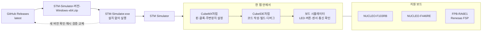
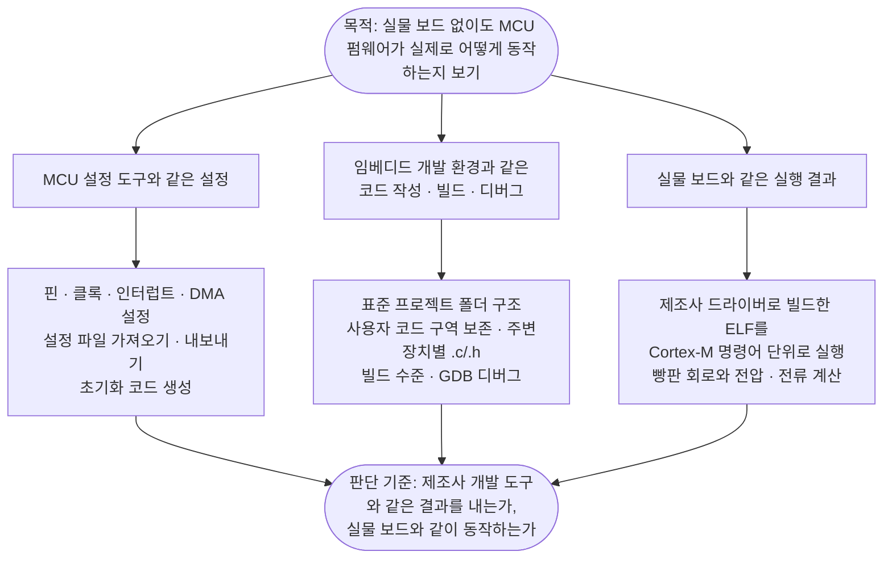
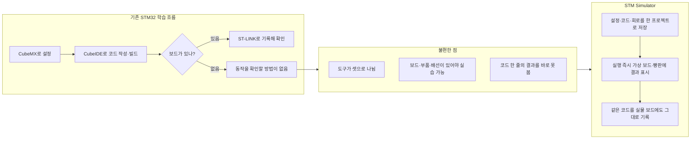
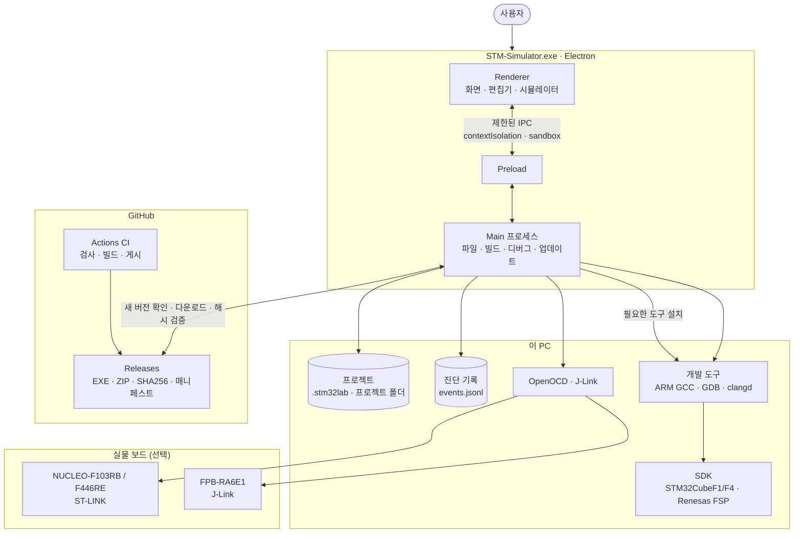
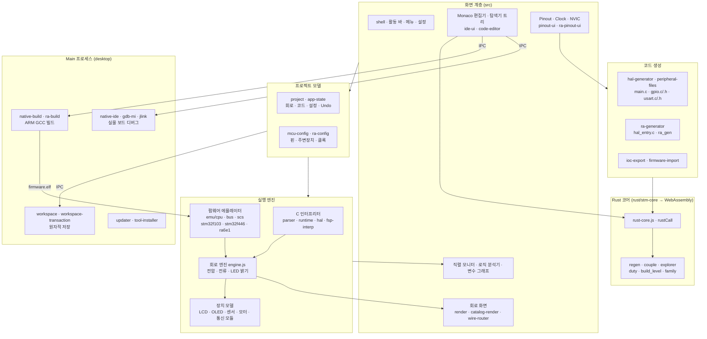
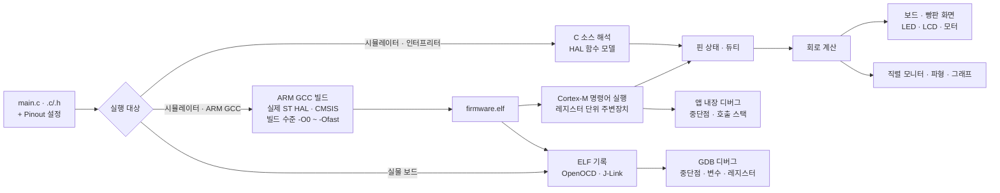
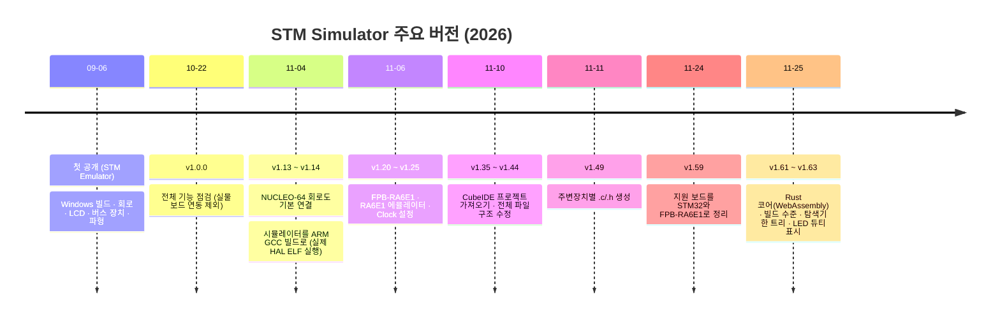
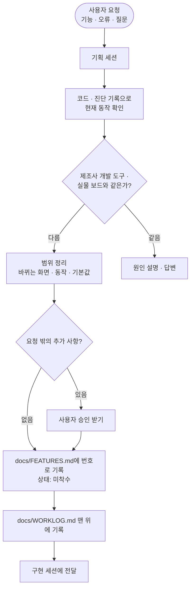
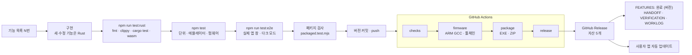
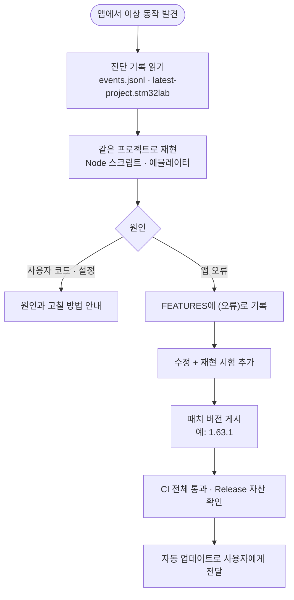

# STM Simulator

## 프로젝트 소개

STM32·Renesas 보드 없이 **설정 → 코드 → 빌드 → 실행 확인**을 한 화면에서 하는 Windows 학습용 IDE입니다.

**[⬇ 최신 EXE 다운로드 (GitHub Releases)](https://github.com/moonsyu/STM-Simulator/releases/latest)**: `STM-Simulator-<버전>-Windows-x64.zip`을 받아 압축을 풀고 `STM-Simulator.exe`를 실행합니다.

| 실행 방식 | 필요한 것 |
|---|---|
| 회로 시뮬레이터 · 펌웨어 에뮬레이터 | EXE만 |
| ARM GCC 빌드 · 실물 보드 기록·디버그 | 앱의 "필요한 도구 설치"로 받는 ARM GCC · SDK · OpenOCD/J-Link |

## 목적

## 개발 계기

## 시스템 아키텍처

## 애플리케이션 아키텍처

### 모듈 구성

### 실행 흐름

## 개발 과정

### 버전 흐름

### 기획 과정

### 구현 · 검증 · 게시 과정

### 수정 과정

## 라이선스

STM Simulator의 소스 코드와 문서는 [MIT 라이선스](LICENSE)로 공개합니다. 사용·복제·수정·배포·판매가 자유롭고, 저작권 표시와 라이선스 문구만 함께 두면 됩니다. 함께 배포하는 Electron·Monaco·DOMPurify 등은 각자의 라이선스를 따르며 [THIRD_PARTY_NOTICES.md](THIRD_PARTY_NOTICES.md)에 적었습니다.

## 권리 관련 안내

STM Simulator는 STMicroelectronics와 Renesas Electronics의 공식 제품이 아닌 개인 학습 프로젝트이며, 두 회사의 후원·승인·제휴를 주장하지 않습니다. STM32, NUCLEO, STM32CubeMX, STM32CubeIDE, Renesas, RA, FSP, e² studio 등 제품명과 상표의 권리는 각 권리자에게 있습니다.

모든 자료의 권리 관계에 대한 법률 검토가 완료된 것은 아닙니다. **저작권·상표권·라이선스 등 권리 관련 문제 또는 법적 문제가 확인되는 경우, 해당 저장소를 삭제 조치하겠습니다.** 관련 문제는 [GitHub Issues](https://github.com/moonsyu/STM-Simulator/issues)를 통해 알려 주세요.
