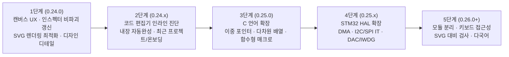

# STM Simulator 디자인 개선 · 기능 추가 및 구현 상세 가이드라인
> 0.26.0에서 작업 화면을 VS Code형으로 개편하고 테스트를 `tests/` 아래로 새로 작성했습니다. 이 문서의 `scripts/*-smoke.cjs`·`*-check.cjs` 경로는 이전 버전의 기록이며, 현재 대응 검사는 `tests/e2e/appearance.e2e.test.mjs`(대비·테마), `tests/e2e/shell.e2e.test.mjs`(화면·키보드), `tests/e2e/workflow.e2e.test.mjs`(편집·실행)입니다.

- **기준 버전**: `0.23.9` (`main` @ `42b2b90`, 작성일: 2026-10-19)
- **목적**: STM Simulator의 **디자인(UI/UX) 개선**과 **신규 기능 추가·구현**을 일관된 품질과 아키텍처 원칙 아래 수행하기 위한 상세 가이드라인 및 단계별 실행 로드맵입니다.
- **제외 범위**: [0.23.8 감사 보고서](audits/2026-10-18-project/REPORT.md)의 A01~A17 결함(저장 일부 실패 복구, 미저장 상태 추적, 창 종료 직전 동기 저장, 터미널 폴더 문맥 전환, Docs 라벨 변경 후 재적용, `sizeof`/unsigned/8진수/enum 상수식 정확성, 포터블 ZIP 배포 등)은 [0.23.9 수정 보고서](audits/0.23.9-fixes/REPORT.md)에서 이미 해결·검증되었으므로 본 문서에서는 다루지 않습니다.

---

## 1. 핵심 설계 불변식 및 테스트 제약 조건 (Design Invariants)

디자인이나 기능을 수정·추가할 때 아래 **6가지 불변식**을 반드시 준수해야 합니다. 기존 스모크 검사 및 대비 검사가 이 조건들을 직접 검증합니다.

### 1.1 `Esc` 키 동작 불변식 (의도된 설계 — 변경 금지)
- **의도된 동작** ([`src/app.js` L309, L439](file:///D:/codex/project/STM-Simulator/src/app.js#L439)):
  1. **보드/빵판 표면 드래그 또는 크기 조절 중 `Esc`**: 이동·크기 조절을 취소하고 원래 위치/크기로 복원합니다.
  2. **배선 작성 중(`pending !== null`) `Esc`**: 작성 중인 배선 초안(`wireDraft`)을 취소하고 선택 모드로 돌아갑니다.
  3. **배선 미작성(`!pending`) 상태에서 부품·배선·그룹·표면이 선택된 경우 `Esc`**: `removeSelected()`를 호출하여 **선택된 항목을 즉시 삭제**합니다.
  4. **그 외 상태(`endpoint` 선택 또는 선택 없음)에서 `Esc`**: 선택 및 모드를 초기화합니다.
- **검증 스크립트**: [`scripts/editor-smoke.cjs` L41–46](file:///D:/codex/project/STM-Simulator/scripts/editor-smoke.cjs#L41-L46)에서 배선 작성 중 `Esc` 취소와 선택된 배선/부품 `Esc` 삭제를 명시적으로 검증합니다. **따라서 선택 상태에서 `Esc`를 단순 선택 해제로 변경해서는 안 됩니다.**

### 1.2 UI 텍스트 명도 대비 불변식 (`4.5:1` 이상)
- **검증 스크립트**: [`scripts/ui-contrast-check.cjs`](file:///D:/codex/project/STM-Simulator/scripts/ui-contrast-check.cjs)가 다크(`jellybean`)·라이트(`github-light`) 등 **52개 UI 상태(약 22,684개 텍스트 노드)**를 50ms 간격으로 순회하며 WCAG AA 기준(`4.5:1` 이상)을 검사합니다.
- **필수 규칙**:
  1. `color`, `background-color`, `border-color`에 **`transition`이나 애니메이션을 절대 적용하지 마십시오.** 50ms 대기 후 중간 보간 색상이 측정되어 대비 검사가 실패합니다.
  2. `background: linear-gradient(...)`를 사용할 때는 반드시 불투명한 단색 **`background-color` 폴백을 함께 선언**하십시오. 대비 검사기는 `getComputedStyle(el).backgroundColor`만 읽고 `backgroundImage`는 무시합니다.
  3. 반투명 배경(`rgba(...)`) 위에 텍스트를 올릴 때는 아래에 깔리는 부모 배경색과의 합성 결과가 다크/라이트 모든 테마에서 `4.5:1` 이상인지 확인하십시오.

### 1.3 테마 및 프리뷰 배경 불변식
- **라이트 기본 테마 에디터 배경**: [`scripts/appearance-smoke.cjs` L19](file:///D:/codex/project/STM-Simulator/scripts/appearance-smoke.cjs#L19)는 `#pref-theme`가 `'stm-light'`일 때 `.monaco-editor`의 배경색이 정확히 `'rgb(252, 253, 252)'`(`#fcfdfc`)인지 검증합니다.
- **부품 모델 프리뷰 배경**: [`scripts/part-preview-ui-check.cjs` L27](file:///D:/codex/project/STM-Simulator/scripts/part-preview-ui-check.cjs#L27)은 `#part-model-preview`의 배경색이 `--ide-chrome`과 일치하는지 검증합니다.

### 1.4 필수 DOM 셀렉터 및 가시성 유지
- `#source-file` `<select>` 요소는 [`scripts/code-reset-check.cjs`](file:///D:/codex/project/STM-Simulator/scripts/code-reset-check.cjs), [`scripts/editor-tools-smoke.cjs`](file:///D:/codex/project/STM-Simulator/scripts/editor-tools-smoke.cjs), [`scripts/hal-smoke.cjs`](file:///D:/codex/project/STM-Simulator/scripts/hal-smoke.cjs)에서 `page.selectOption('#source-file', ...)`로 직접 조작하므로 `display: none`이나 `hidden`으로 숨기지 마십시오.
- 주요 컨트롤 ID(`#run`, `#step`, `#undo`, `#redo`, `#delete`, `#rotate`, `#pinout-open`, `#firmware-mode`, `#hal-example`, `#hal-example-search`, `#part-search`, `#pin-search`, `#serial-target` 등)와 `data-tab`, `data-monitor`, `data-add`, `data-part`, `data-wire`, `data-endpoint` 속성을 유지하십시오.

### 1.5 무제한 캔버스 좌표계 불변식
- 회로 캔버스는 `0~6000` 같은 임의의 고정 경계로 부품을 가두지 않습니다([`docs/IDE.md` L57](file:///D:/codex/project/STM-Simulator/docs/IDE.md#L57)). 유한한 수(`Number.isFinite`) 범위 안에서 자유 배치를 허용하고, 화면 밖 요소는 `fitView()`(`#zoom-reset`)로 언제든 찾아갈 수 있어야 합니다.

### 1.6 저장 및 복구 안전성 불변식
- 코드/회로 수정 시 `checkpoint()`(히스토리 스냅샷)와 `dirty = true`(미저장 표시)가 누락되지 않아야 하며, 워크스페이스 파일 저장은 [`desktop/workspace.cjs`](file:///D:/codex/project/STM-Simulator/desktop/workspace.cjs)의 원자적 저널·백업 경로를 통해 이루어져야 합니다.

---

## 2. 디자인 개선 상세 가이드라인 (UI/UX Design System)

### 2.1 색상 토큰 체계 (`--ide-*` CSS Custom Properties)
모든 신규 UI 컴포넌트와 스타일 수정은 하드코딩된 색상 대신 [`src/preferences.css`](file:///D:/codex/project/STM-Simulator/src/preferences.css)에서 주입되는 테마 변수를 우선 사용해야 합니다.

| 토큰 이름 | 용도 | 사용 지침 |
|---|---|---|
| `--ide-background` | 편집기·주 작업 영역 기본 배경 | 코드 편집기, 모달 본문, 입력창 기본 배경에 사용 |
| `--ide-panel` | 도크 패널·카드·인스펙터 섹션 배경 | 사이드바 내부 카드(`.inspector-card`, `.docs-card`) 배경 |
| `--ide-chrome` | 상단바·툴바·탭바·프리뷰 프레임 배경 | `.topbar`, `.ide-toolbar`, `.panel-tabs`, `#part-model-preview` |
| `--ide-foreground` | 기본 본문 텍스트 색상 | `--ide-background`, `--ide-panel`, `--ide-chrome` 위에서 최소 `7:1` 대비 유지 |
| `--ide-muted` | 보조 설명·레이블·비활성 탭 텍스트 | 최소 `4.5:1` 명도 대비 유지 (절대 `opacity: 0.5` 등으로 흐리게 처리하지 말 것) |
| `--ide-border` | 패널 경계선·구분선·입력창 테두리 | `1px solid var(--ide-border)` 기본 사용 |
| `--ide-accent` | 주요 강조·활성 탭·선택 테두리·포커스 링 | 활성 상태 표시 및 주요 액션 버튼 강조 |
| `--ide-selection` | 목록/코드 선택 영역 배경 | 선택된 항목 배경에 사용하되 텍스트 대비 `4.5:1` 확인 필수 |
| `--ide-error` / `--ide-warning` | 오류·경고 배지 및 진단 텍스트 | 배경과 조합 시 명도 대비 `4.5:1` 이상 보장 |
| `--ide-net` | 회로 연결망(Net) 강조 색상 | 연결된 핀·배선 하이라이트 |

### 2.2 타이포그래피 및 수치 표기 규칙
1. **기본 UI 폰트**: `'Segoe UI Variable', 'Segoe UI', 'Malgun Gothic', sans-serif`, 기본 크기 `var(--ide-ui-size, 13px)`.
2. **코드·터미널·수치 폰트**: `var(--ide-font, 'Cascadia Code', Consolas, monospace)`, 터미널 크기 `var(--ide-terminal-size, 12.5px)`.
3. **고정폭 숫자(`tabular-nums`) 의무 적용**:
   - 시뮬레이션 시간(`#sim-time`), 전류(`#sim-current`), 인스펙터 전압/전류(`#part-voltage`, `#part-current`, `#wire-voltage`), 회전 각도, 줌 배율(`#zoom-reset`), 크기 조절 표시(`#resize-size`) 등 **실시간으로 변하는 모든 숫자 요소에는 `font-variant-numeric: tabular-nums`를 적용**하여 숫자가 바뀔 때 레이아웃이 흔들리지 않게 합니다.
4. **말줄임 및 툴팁 원칙**:
   - 한 줄 레이블·탭·드롭다운은 `white-space: nowrap; overflow: hidden; text-overflow: ellipsis`를 적용하고, 잘릴 가능성이 있는 동적 텍스트(예: `#workspace-path`, 긴 부품 이름, 핀 신호 설명)에는 반드시 `title` 속성을 함께 부여합니다.

### 2.3 레이아웃 밀도 및 여백(Spacing) 표준
제한된 노트북 화면(`1366×768`, `1024×640`)에서도 **회로 캔버스와 코드 편집기가 전체 화면의 70% 이상**을 차지하도록 크롬(상단바·툴바·패널 헤더)의 수직 높이를 절제합니다.
- **4px 기반 간격 스케일**: `4px` (인라인 아이콘·배지 간격) → `6px` (툴바 버튼 간격, 폼 내부 간격) → `8px` (카드 내부 패딩) → `10px~12px` (패널 좌우 패딩).
- **크롬 높이 상한**:
  - `.topbar`: 높이 `38px~42px` 이내, 패딩 `4px 10px`
  - `.ide-toolbar`: 높이 `34px~38px` 이내, 패딩 `4px 10px`
  - `.dock-heading`, `.panel-tabs`, `.source-tabs`: 높이 `30px~34px` 이내
- **단일 스크롤 원칙**:
  - 좌측 부품 목록(`#part-list`), 우측 인스펙터(`#inspect-panel`), 장치 Docs 본문(`#device-docs-detail`), 하단 콘솔(`#console-output`)은 **각각 자신의 컨테이너 내부에서만 세로 스크롤**되어야 하며, 바깥 `.sidebar`나 `body`에 이중 스크롤바가 생기지 않도록 `min-height: 0`과 `flex: 1 1 auto`를 명확히 지정합니다.

### 2.4 인터랙티브 상태(State) 디자인 규칙
모든 클릭 가능한 요소(`button`, `select`, `[role="button"]`, `.part-card`, `.swatch`, `.circuit-issue`)는 아래 5가지 상태를 시각적으로 명확히 구분해야 합니다.
1. **Default**: 명확한 경계선(`1px solid var(--ide-border)`)과 읽기 쉬운 전경색.
2. **Hover (`:hover:not(:disabled)`)**: 배경 명도를 한 단계 변화시키고 테두리를 강조합니다(단, `transition` 없이 즉시 전환).
3. **Focus (`:focus-visible`)**: 키보드 탐색 시 한눈에 보이도록 `outline: 2px solid var(--ide-accent); outline-offset: 1px`를 일관되게 표시합니다.
4. **Active / Selected (`.active`, `[aria-selected="true"]`, `[aria-pressed="true"]`)**: 단순 배경색 변화뿐 아니라 굵은 글씨(`font-weight: 700`) 또는 하단/좌측 강조선(`box-shadow: inset 0 -2px 0 var(--ide-accent)`)을 병행하여 색각 이상 사용자도 구분할 수 있게 합니다.
5. **Disabled (`:disabled`)**: `opacity`를 낮추어 글자 대비가 `4.5:1` 미만으로 떨어지는 실수를 피하고, 명시적인 비활성 배경색/전경색 조합을 지정하며 `cursor: not-allowed`를 부여합니다.

### 2.5 회로 캔버스 및 SVG 시각 계층 가이드라인
1. **레이어 순서 유지** ([`index.html`](file:///D:/codex/project/STM-Simulator/index.html)):
   - `surface` (보드·기본 빵판) → `breadboard-layer` (추가 빵판) → `net-layer` (연결망 금색 강조) → `wire-layer` (점퍼선) → `part-layer` (부품 몸체 및 다리) → `endpoint-layer` (핀/홀 클릭 영역) → `search-layer` (핀 검색 하이라이트) → `wire-handle-layer` (배선 꺾임점 핸들) → `preview-layer` (장착 미리보기·배선 드래그 프리뷰·마키 선택 박스).
2. **비례 무관 선 두께 (`vector-effect="non-scaling-stroke"`)**:
   - 선택 테두리, 배선 꺾임점 핸들, 마키 선택 상자 등 줌 배율과 무관하게 일정한 시인성을 유지해야 하는 UI 오버레이 요소에는 `vector-effect="non-scaling-stroke"` 또는 `svg.getScreenCTM()?.a` 역수 스케일링을 적용합니다.
3. **전압·신호 상태 시각화**:
   - 실행 중 핀/배선 hover 및 인스펙터에서 논리 상태(`HIGH ≥ 2.0V`, `LOW ≤ 0.8V`, `아날로그/중간`, `부유(Floating)`)를 숫자 전압과 함께 상태 배지로 병기합니다.

---

## 3. 기능 추가 및 구현 아키텍처 가이드라인

### 3.1 캔버스 편집 도구 확장 원칙
- **입력 처리 위치**: [`src/app.js`](file:///D:/codex/project/STM-Simulator/src/app.js)의 `svg` 포인터 이벤트(`pointerdown`, `pointermove`, `pointerup`, `wheel`, `dblclick`, `contextmenu`)와 전역 `keydown` 핸들러, 그리고 순수 편집 헬퍼 모듈인 [`src/circuit-edit.js`](file:///D:/codex/project/STM-Simulator/src/circuit-edit.js)에 분리하여 구현합니다.
- **순수 함수 우선**: 선택 계산, 영역 교차 판정, 정렬 좌표 계산, 복제 데이터 생성 등은 DOM에 의존하지 않는 순수 함수로 [`src/circuit-edit.js`](file:///D:/codex/project/STM-Simulator/src/circuit-edit.js)에 작성하고 `tests/circuit.test.js`에서 단위 테스트로 먼저 검증합니다.
- **실행 중 편집 차단**: `running()`이 `true`일 때는 실시간 조작이 허용된 입력(`버튼 누르기`, `슬라이드 스위치 전환`, `data-live="true"` 센서 슬라이더, `보드 RESET`) 외의 회로 구조 변경을 차단하고, 모든 편집 동작 전에는 `checkpoint()`를 호출해 `Ctrl+Z`로 복원할 수 있게 합니다.

### 3.2 인스펙터 및 실시간 측정값 갱신 원칙
- **구조 렌더링과 값 패치의 분리**:
  - `inspector()`는 **선택 대상(`selection`)이 바뀌거나 편집 속성이 변경될 때만** DOM 구조를 생성합니다.
  - 시뮬레이션 틱(20ms 주기) 중에는 `inspector()` 전체를 다시 호출하여 `innerHTML`을 덮어쓰지 않고, `updateReadouts()`에서 `#part-voltage`, `#part-current`, `#part-power`, `#part-live`, `#wire-voltage`, `#endpoint-voltage` 등 **측정값 전용 요소의 내용만 부분 갱신**합니다.
  - 이렇게 해야 실행 중 사용자가 인스펙터를 스크롤하거나 슬라이더·입력창을 조작할 때 스크롤 위치나 포커스가 초기화되지 않습니다.

### 3.3 C 컴파일러 · 런타임 확장 원칙
- **파이프라인 구조**:
  1. [`src/hal-source.js`](file:///D:/codex/project/STM-Simulator/src/hal-source.js): 전처리기(`#include`, `#define`, `#ifdef`/`#ifndef`/`#if`/`#else`/`#endif`), 헤더 병합, 심볼/상수 테이블 준비.
  2. [`src/parser.js`](file:///D:/codex/project/STM-Simulator/src/parser.js): 토크나이저 및 재귀 하강 파서 → AST 생성 (`loc` 줄 번호 포함).
  3. [`src/runtime.js`](file:///D:/codex/project/STM-Simulator/src/runtime.js): 제너레이터(`yield*`) 기반 협력적(cooperative) AST 인터프리터 + 메모리 셀(`declareCell`, `pointerCell`), 구조체 레이아웃, 스텝 실행(`debug`) 및 무한 루프 방어(`stepLimit`).
  4. [`src/c-inline.js`](file:///D:/codex/project/STM-Simulator/src/c-inline.js): 장치 Docs의 보조 함수를 `main` 내부 블록으로 펼치는 AST → C 코드 변환기.
- **문법 추가 시 체크리스트**:
  - [`src/parser.js`](file:///D:/codex/project/STM-Simulator/src/parser.js)에 새 AST 노드를 추가할 때는 반드시 **(1) [`src/runtime.js`](file:///D:/codex/project/STM-Simulator/src/runtime.js)의 실행/타입/크기(`sizeof`) 처리**와 **(2) [`src/c-inline.js`](file:///D:/codex/project/STM-Simulator/src/c-inline.js)의 코드 변환 처리**를 동시에 구현해야 합니다.
  - 새로운 C 연산/타입 규칙은 실제 호스트 GCC 및 Cortex-M4 ABI 기대값과 일치하는지 `tests/hal.test.js`에 대조 테스트를 추가합니다.

### 3.4 STM32 HAL 및 주변장치 추가 원칙
- **구성 파일**:
  - 핀/AF 라우팅 및 `.ioc` 임포트: [`src/mcu-config.js`](file:///D:/codex/project/STM-Simulator/src/mcu-config.js)
  - CubeMX 초기화 코드 생성: [`src/hal-generator.js`](file:///D:/codex/project/STM-Simulator/src/hal-generator.js)
  - HAL 상수·구조체 정의: [`src/hal-source.js`](file:///D:/codex/project/STM-Simulator/src/hal-source.js)
  - 런타임 HAL API 디스패치: [`src/hal.js`](file:///D:/codex/project/STM-Simulator/src/hal.js), [`src/hal-timers.js`](file:///D:/codex/project/STM-Simulator/src/hal-timers.js), [`src/catalog-peripherals.js`](file:///D:/codex/project/STM-Simulator/src/catalog-peripherals.js)
- **오류 처리 원칙**:
  - 핀이 활성화되지 않았거나 AF/클럭/전원/배선이 맞지 않을 때는 조용히 무시하지 않고, 학습자가 원인을 즉시 알 수 있는 한국어 진단 메시지를 던지거나 `HAL_ERROR` / `HAL_TIMEOUT` / `HAL_BUSY`를 명확히 반환합니다.

---

## 4. 단계별 실행 로드맵 (1단계부터 즉시 착수)



---

## 5. [1단계 · 즉시 착수] `0.24.0` 캔버스 UX · 인스펙터 · 렌더링 및 디자인 개선 명세

로드맵 첫 단계(`0.24.0`)는 사용자가 매 순간 체감하는 **회로 캔버스 조작감, 실행 중 인스펙터 안정성, 드래그 렌더링 성능, 시각적 피드백**을 개선하는 5개 핵심 작업(`Step 1-1` ~ `Step 1-5`)으로 구성됩니다.

### Step 1-1. 커서 위치 중심 마우스 휠 줌 및 트랙패드 핀치 줌 개선
- **현재 문제**: [`src/app.js` L311–312](file:///D:/codex/project/STM-Simulator/src/app.js#L311-L312)의 `zoom(mult)` 함수가 항상 화면 중앙(`view.x += (view.w - nw) / 2`)을 기준으로 확대/축소하여, 특정 핀이나 부품을 확대할 때 목표 지점이 화면 밖으로 밀려납니다.
- **구현 명세**:
  1. `zoom(mult, anchor = null)`로 시그니처를 확장합니다.
  2. 툴바의 `+`/`-` 버튼(`#zoom-in`, `#zoom-out`)은 기존처럼 화면 중앙(`anchor = null`)을 기준으로 확대/축소합니다.
  3. `svg`의 `wheel` 이벤트에서는 마우스 커서의 SVG 좌표 `const p = point(e)`를 `anchor`로 전달하여, 확대/축소 전후에 커서 아래의 회로 좌표가 고정되도록 계산합니다:
     ```js
     function zoom(mult, anchor = null) {
       const nw = Math.min(6000, Math.max(100, view.w * mult)), nh = nw * 730 / 1120;
       if (!Number.isFinite(nw) || !Number.isFinite(nh)) return;
       const rx = anchor ? (anchor.x - view.x) / view.w : 0.5;
       const ry = anchor ? (anchor.y - view.y) / view.h : 0.5;
       view.x += (view.w - nw) * rx;
       view.y += (view.h - nh) * ry;
       view.w = nw;
       view.h = nh;
       viewUpdate();
     }
     svg.addEventListener('wheel', e => {
       e.preventDefault();
       const step = e.ctrlKey ? (e.deltaY > 0 ? 1.04 : 1 / 1.04) : (e.deltaY > 0 ? 1.08 : 1 / 1.08);
       zoom(step, point(e));
     }, { passive: false });
     ```
- **검증 기준**: 임의의 좌표 `(px, py)`에서 `wheel` 이벤트 발생 시 `point(e)` 좌표가 줌 전후 오차 `1e-3` 이내로 유지되는지 확인합니다.

### Step 1-2. 마키(드래그 박스) 다중 선택, `Ctrl+A` 전체 선택, `Ctrl+D` 즉시 복제
- **현재 문제**: 다중 선택을 하려면 부품을 일일이 `Shift+클릭`해야 하며, 영역 드래그 선택(`Marquee Selection`), 전체 선택(`Ctrl+A`), 즉시 복제(`Ctrl+D`)가 없습니다.
- **구현 명세**:
  1. **마키(드래그 박스) 선택**:
     - 편집 중(`!running()`) 선택 모드(`mode === 'select' && !pending`)에서 **빈 캔버스 배경을 `Shift + 좌클릭 드래그`**하면 화면 팬(`pan`) 대신 마키 선택(`drag = { type: 'marquee', start: point(e), current: point(e), additive: true }`)을 시작합니다. (단순 빈 공간 좌클릭/중클릭 드래그는 기존과 동일하게 화면 이동 `pan` 유지)
     - `pointermove` 시 `#preview-layer`에 점선 사각형(`<rect class="marquee-box" ... vector-effect="non-scaling-stroke"/>`)을 표시합니다.
     - `release` 시 사각형 영역(`minX..maxX`, `minY..maxY`) 안에 중심점이 포함된 부품(`project.components`)과 모든 끝점/경유점이 포함된 배선(`project.wires`)을 찾아 `selection = { type: 'group', parts, wires }`로 설정합니다.
  2. **`Ctrl+A` 전체 선택**:
     - 코드 편집기나 입력창에 포커스가 없을 때(`!editing && !running()`) `Ctrl+A`(`Cmd+A`)를 누르면 현재 회로의 모든 부품과 배선을 그룹 선택합니다.
  3. **`Ctrl+D` 선택 항목 즉시 복제**:
     - `!editing && !running() && selection` 상태에서 `Ctrl+D`(`Cmd+D`)를 누르면 `copyCircuit()` 후 `pasteCircuit()`을 연속 실행하여 한 번에 복제본을 생성·선택합니다.
  4. **`Esc` 삭제 불변식 유지**:
     - 마키 선택이나 `Ctrl+A`로 생성된 `group` 선택 상태에서도 `Esc` 키는 기존 설계대로 `removeSelected()`를 호출합니다.
- **수정 대상 파일**: [`src/circuit-edit.js`](file:///D:/codex/project/STM-Simulator/src/circuit-edit.js) (`boxSelection(project, rect)` 순수 함수 추가), [`src/app.js`](file:///D:/codex/project/STM-Simulator/src/app.js), [`src/style.css`](file:///D:/codex/project/STM-Simulator/src/style.css).

### Step 1-3. 실행 중 인스펙터 비파괴(DOM 패치) 갱신
- **현재 문제**: [`src/app.js` L354](file:///D:/codex/project/STM-Simulator/src/app.js#L354)에서 시뮬레이션 실행 중 10틱(200ms)마다 `inspector()`를 호출해 `el.innerHTML` 전체를 다시 씁니다. 이 때문에 실행 중 인스펙터를 스크롤하거나 버튼을 클릭하려 할 때 DOM이 교체되어 스크롤이 튀거나 클릭이 유실될 수 있습니다.
- **구현 명세**:
  1. [`src/app.js`](file:///D:/codex/project/STM-Simulator/src/app.js)의 `inspector()`에 포함된 동적 측정값 요소들에 명확한 ID를 부여합니다:
     - 연결점(`endpoint`): `<b id="endpoint-voltage">`, `<b id="endpoint-connected">`
     - 부품(`part`): `<b id="part-voltage">`, `<b id="part-current">`, `<b id="part-power">`, `<div id="part-live">`
     - 배선(`wire`): `<b id="wire-voltage">`, `<b id="wire-connected">`
  2. `updateReadouts()`에서 현재 선택 타입(`part`, `wire`, `endpoint`)에 해당하는 측정값 텍스트/HTML만 부분 갱신합니다.
  3. [`src/app.js` L354](file:///D:/codex/project/STM-Simulator/src/app.js#L354)의 주기적 `inspector()` 전체 재렌더링 호출을 제거하고 `updateReadouts()`만으로도 모든 실시간 수치가 최신 상태로 유지되게 합니다.

### Step 1-4. 캔버스 드래그 및 시뮬레이션 렌더링 성능 최적화
- **현재 문제**: 부품이나 그룹을 드래그할 때 매 `pointermove`마다 `refresh()`가 호출되어 빵판·배선·부품·엔드포인트 전체 SVG 문자열을 재생성하고 `innerHTML`로 파싱합니다.
- **구현 명세**:
  1. `refresh({ preserveWires = false, preserveBreadboards = false, preserveEndpoints = false } = {})` 옵션을 세분화하거나, 빵판 목록과 표면이 바뀌지 않은 일반 부품 이동 중에는 `#breadboard-layer`를 재렌더링하지 않도록 캐시 키(`breadboardKey`)를 도입합니다.
  2. 실시간 수치 요소(`#sim-time`, `#sim-current`, `#part-voltage`, `#part-current`, `#wire-voltage`, `#endpoint-voltage`, `#zoom-reset`)에 CSS `font-variant-numeric: tabular-nums`를 일괄 적용합니다.

### Step 1-5. 인스펙터 배선 색상 변경 UI 및 전압 논리 상태 배지 디자인 개선
- **현재 문제**: 이미 배치된 배선의 색상을 바꾸려면 좌측 사이드바의 작은 팔레트를 찾아 눌러야 하며, 핀이나 배선의 전압이 HIGH인지 LOW인지 부유 상태인지 직관적인 배지가 없습니다.
- **구현 명세**:
  1. **배선 인스펙터 내 색상 스와치 제공**: 배선(`selection.type === 'wire'`) 선택 시 인스펙터 카드 안에 기본 배선 색상 스와치 행을 함께 렌더링하여 시선을 옮기지 않고 즉시 색상을 바꿀 수 있게 합니다.
  2. **전압 논리 상태 배지 표시**: 연결점(`endpoint`)과 배선(`wire`) 인스펙터의 전압 표시 옆에 현재 전압 수준에 따른 상태 텍스트(`HIGH`, `LOW`, `ANALOG`, `부유`)를 함께 표기합니다.

---

## 6. 후속 단계 로드맵 요약 (2단계 ~ 5단계)

### 2단계 (`0.24.x`): 코드 편집기 · IDE · 프로젝트 학습 경험 개선
- **E-01 런타임 오류 위치 에디터 표시**: 컴파일/런타임 오류 메시지의 줄 번호(`N행: ...`)를 파싱하여 Monaco 에디터에 오류 마커(`setModelMarkers`)를 표시하고, 콘솔 오류 줄 클릭 시 해당 줄로 커서를 이동합니다.
- **E-02 내장 HAL API 자동 완성 및 시그니처 힌트**: 네이티브 `clangd`를 설치하지 않은 환경에서도 시뮬레이터가 지원하는 `HAL_GPIO_*`, `HAL_UART_*`, `HAL_TIM_*`, `HAL_ADC_*`, `HAL_I2C_*`, `HAL_SPI_*` 함수와 상수에 대해 Monaco `CompletionItemProvider` 및 `HoverProvider`를 기본 제공합니다.
- **C-08 회로 이미지 내보내기**: 현재 회로 캔버스를 보고서·과제 첨부용 SVG/PNG 파일로 저장하는 버튼 추가.
- **P-01 최근 프로젝트 및 다중 자동 저장 스냅샷**: 최근 열었던 프로젝트 목록과 시점별 자동 저장 복원 슬롯 제공.
- **P-02 인터랙티브 입문 가이드**: 첫 사용자를 위한 3단계 회로 구성·실행 가이드 제공.

### 3단계 (`0.25.0`): C 인터프리터 문법 확장
- **L-01 이중 포인터(`**`) 및 포인터 배열**: 문자열 테이블(`const char *labels[]`) 및 다중 간접 참조 지원.
- **L-02 다차원 배열(`a[M][N]`)**: 폰트/비트맵/행렬 데이터 선언·초기화·인덱싱 지원.
- **L-03 포인터 및 함수 포인터 `typedef`**: 콜백 테이블 및 상태 머신 패턴 지원.
- **L-04 함수형 매크로(`#define MAX(a, b) ...`) 및 `#if` 상수식 평가**: 헤더 호환성 확대.

### 4단계 (`0.25.x`): STM32 HAL 및 주변장치 확장
- **H-01 HAL DMA 지원**: `HAL_ADC_Start_DMA`, `HAL_UART_Transmit_DMA`, `HAL_UART_Receive_DMA` 및 완료 콜백 시뮬레이션.
- **H-02 비동기 I²C / SPI (`_IT`)**: `HAL_I2C_Master_Transmit_IT`, `HAL_SPI_TransmitReceive_IT` 및 완료 인터럽트 콜백.
- **H-03 내장 DAC 및 IWDG(독립 워치독)**: 아날로그 파형 출력 및 워치독 타임아웃 리셋 학습 지원.

### 5단계 (`0.26.0+`): 코드 모듈화 · 접근성 · 다국어
- **S-02 `src/app.js` 모듈 분리**: 캔버스 입력, 인스펙터 렌더링, 시뮬레이션 루프, 파일 입출력을 개별 모듈로 분리.
- **A-01~A-04 접근성 강화**: `prefers-reduced-motion` 미디어 쿼리 대응, 캔버스 부품 키보드 탐색/이동, SVG 내부 텍스트 명도 대비 자동 검사 추가.
- **A-05 다국어(i18n) 리소스 분리**: 한국어/영어 전환 구조 마련.

---

## 7. 단계별 구현 후 필수 검증 절차 (Verification Checklist)

각 단계의 기능을 구현하거나 디자인을 수정한 뒤에는 커밋 전에 반드시 아래 순서대로 검증을 통과해야 합니다.

```powershell
# 1. Monaco 에디터 및 테마 번들 빌드
npm run build:editor

# 2. 전체 단위 테스트 실행 (365개 이상 전체 통과 필수)
node --test (Get-ChildItem tests/*.test.js).FullName

# 3. 52개 화면 상태 명도 대비 자동 검사 (저대비 0건 필수)
node scripts/ui-contrast-check.cjs

# 4. 핵심 UI 스모크 테스트 (Esc 삭제 불변식, 테마 배경, 프리뷰, IDE, 장치 Docs 검증)
node scripts/editor-smoke.cjs
node scripts/appearance-smoke.cjs
node scripts/part-preview-ui-check.cjs
node scripts/ide-smoke.cjs
node scripts/device-docs-smoke.cjs
```
